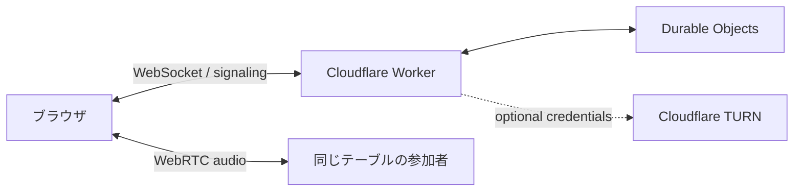

# LOWTALK

声だけで、ふらっと。

LOWTALKは、顔を出さずに立ち寄れる小さな音声空間です。4つのテーブルから好きな席を選び、話したいときに話し、聞くだけでも過ごせます。

[公開デモを開く](https://lowtalk.yoshihiko-sato.workers.dev/)


## このプロジェクトについて

LOWTALKの音声は、WebRTCによるPeer to Peer（P2P）で参加者同士を接続します。TURNを使用しない通常の接続では、音声データはLOWTALKのWorkerやDurable Objectを経由せず、同じテーブルにいる参加者間で直接送受信されます。サーバーが担うのは、接続相手を見つけるためのシグナリング、在席状態、店舗設定、チャットなどです。

P2P meshでは参加者が増えるほど、それぞれの端末が送受信する音声データと接続数も増えます。その負荷を考慮し、ひとつのテーブルは最大6名としています。

このプロジェクトは、大手プラットフォームの管理から離れ、自分が管理するCloudflare環境で小さなトークルームを運用できる仕組みを作ることを目的としています。店の名前、開閉、入室方法、チャット、データの保存方針を自分で決められる、持ち運び可能な音声空間を目指しています。

## 特徴

- 音声のみ。カメラ機能なし
- 4テーブル、各6人、全体で最大24人
- テーブル間をいつでも移動可能
- 話していることを柔らかな光で示す音声インジケーター
- 店内で共有され、投稿元のテーブル名が小さく添えられる補助チャット
- チャットは最大50件、投稿から24時間で自動削除
- 切断時の自動再接続と、応答がない席の自動整理
- 店名、曜日ごとの営業時間、臨時開店・臨時休業、来店用合言葉を管理画面から設定
- 閉店中は次の開店時刻を表示
- 店名の下に、お店からのメッセージを数行表示
- 使うテーブルを1〜4卓から選択
- Cloudflare Workersだけで配信・状態管理

来店者のアカウント登録はありません。名前を入力して席につくだけです。

## AIと一緒に運営する

LOWTALKは、ターミナル操作を利用者へ要求する代わりに、AIエージェントへデプロイや復旧を依頼できる構成を目指しています。

リポジトリを開いたAIへ、例えば次のように依頼します。

> このLOWTALKをCloudflareへデプロイしてください。公開URLを確認したあと、管理者用の一時パスワードも発行してください。

AIは同梱された[運用Skill](skills/lowtalk-operator/SKILL.md)と[エージェント向け指示](AGENTS.md)に従い、テスト、デプロイ、公開確認、一時パスワードの発行を行います。

AIが知るのは30分で失効する一時パスワードだけです。初回ログイン後、利用者はブラウザ上で本パスワードへ変更します。本パスワードをAIとのチャットへ書く必要はありません。

新しいバージョンが出たときは、次のように依頼します。

> LOWTALKを最新版に更新してください。

AIは手元のバージョンと公開リポジトリの最新版を比べ、変更内容を説明したうえで、確認を取ってから更新・デプロイします。店の設定、チャット、管理者パスワードはそのまま引き継がれます。

パスワードを忘れた場合も、AIへ次のように依頼できます。

> LOWTALKの管理者パスワードをリセットしてください。

新しい一時パスワードが発行され、以前の管理者セッションはすべて無効になります。

## 構成



- 静的画面とAPI：Cloudflare Workers Static Assets
- 在席状態とWebRTCシグナリング：テーブルごとのDurable Object
- 音声：同じテーブルの参加者間を結ぶWebRTC P2P mesh
- 店舗設定とチャット：SQLite-backed Durable Object storage
- 通信補助：Cloudflare STUN、任意でCloudflare TURN

別途データベースを用意する必要はありません。

## 必要なもの

- Node.js 20以降
- npm
- Cloudflareアカウント

## ローカルで動かす

```sh
npm install
npm run dev
```

表示された `http://localhost:8787` を開きます。マイクはHTTPSまたは `localhost` で利用できます。同じネットワーク上の別端末からHTTPで開いた場合、画面は表示できてもブラウザの制限でマイクを利用できないことがあります。

ローカル用のSecretが必要な場合は、`.dev.vars.example` を `.dev.vars` にコピーして値を変更してください。`.dev.vars` はGitの管理対象外です。

## Cloudflareへデプロイする

AIを使わず手動で実行する場合は、次の手順です。

```sh
npm install
npx wrangler login
npm test
npm run deploy
```

デプロイ結果に表示されたHTTPS URLを指定し、管理者用の一時パスワードを発行します。

```sh
npm run admin:reset -- --url https://your-worker.workers.dev
```

一時パスワードは30分で失効します。フッター右端の「管理」からログインすると、本パスワードの設定画面が表示されます。変更後、一時パスワードは利用できません。

同じコマンドは、管理者パスワードを忘れた場合のリセットにも使えます。

## 管理者ができること

- お店の名前を変更
- 店名の下に表示するメッセージを設定（300文字まで）
- 使うテーブルを選ぶ（1〜4卓。使わないテーブルは画面に出ず、新しく座ることもできません）
- 曜日ごとの営業時間を設定（21:00〜02:00のように日付をまたぐ時間も可）
- 今すぐ開ける／今すぐ閉める（手動の操作は営業時間より優先され、次の区切りで営業時間どおりに戻ります）
- 次回の営業を休みにする
- 来店用の合言葉を設定・解除
- チャットを個別削除
- チャットをスコープごとに全消去
- 管理者パスワードを変更

閉店は新規入店だけを止めるソフトクローズです。営業時間の終わりや手動の閉店でも、すでに入店している人の音声接続は切断しません。

どの曜日も営業時間を設定しない場合は、営業時間なしで常に開店し、手動の開閉だけで運用します。時刻は、営業時間を保存したブラウザのタイムゾーン（通常は Asia/Tokyo）を基準にします。

## TURNを利用する

通常はSTUNを使って参加者同士を直接接続します。企業ネットワークや一部のモバイル回線など、P2P接続が難しい環境にも対応する場合はCloudflare RealtimeのTURNを設定します。

```sh
npx wrangler secret put TURN_KEY_ID
npx wrangler secret put TURN_API_TOKEN
```

設定後は、入室時に短期ICE資格情報をサーバー側で発行します。長期APIトークンをブラウザへ渡すことはありません。TURNが未設定でもアプリは動作しますが、直結できない回線同士では音声がつながらない場合があります。

## バージョン

バージョン番号は `package.json` の `version` で管理し、画面のフッターに表示します。変更内容は `CHANGELOG.md` に記録します。

公開する側は、変更を入れるたびに番号を上げ、`CHANGELOG.md` に変更点を追記してください（例：`npm version patch --no-git-tag-version`）。運用者のAIは、この2つを見て更新の有無と内容を判断します。

## テスト

入力値とシグナリングメッセージのテスト：

```sh
npm test
```

ローカルサーバーを起動した状態で、6席の入室と満席判定を確認：

```sh
npm run test:smoke
```

別URLを検証する場合：

```sh
LOWTALK_URL=https://your-worker.workers.dev npm run test:smoke
```

## セキュリティとデータ

- 管理者の本パスワードはPBKDF2で導出したハッシュだけを保存します。
- AIが発行する一時パスワードは30分で失効し、本パスワードへの変更を強制します。
- 管理者リセット時はセッション署名鍵と認証世代を更新し、既存セッションを無効化します。
- 管理者用Secret、一時リセットトークン、本パスワードをリポジトリへ保存しません。
- チャットは投稿から24時間で削除され、長期アーカイブを目的としません。
- 来店用の合言葉は任意です。未設定の場合、URLを知っている人が入店できます。
- 合言葉は同じ接続元から10分間に10回、管理者パスワードは15分間に5回間違えると、一定時間入力を受け付けません。
- 店内チャットは席についている人だけがWebSocket経由で投稿でき、名前とテーブルはサーバー側の在席情報から付きます。
- 音声はP2Pで直接つながります。

## 現在の制約

- 1店舗・4テーブル固定です。
- 音声は最大6人のP2P meshです。大人数向けのSFU構成ではありません。
- TURNは自動設定されません。必要な場合はCloudflare Realtimeの認証情報を設定してください。
- 通報、BAN、ユーザーアカウント、チャット編集はありません。
- 管理者の再発行には、そのWorkerを操作できるCloudflareの権限が必要です。

## 主なファイル

```text
public/                         ブラウザ画面、スタイル、画像
src/worker.js                   Worker、Durable Object、管理API
src/protocol.js                 入力値とWebSocketメッセージの検証
src/schedule.js                 営業時間と臨時開閉の判定
scripts/admin-reset.mjs         AI／運営者用の管理者リセット
CHANGELOG.md                    バージョンごとの変更点
skills/lowtalk-operator/        AIエージェント用の運用Skill
test/                           プロトコル・スモークテスト
wrangler.jsonc                  Cloudflare Workers設定
```
